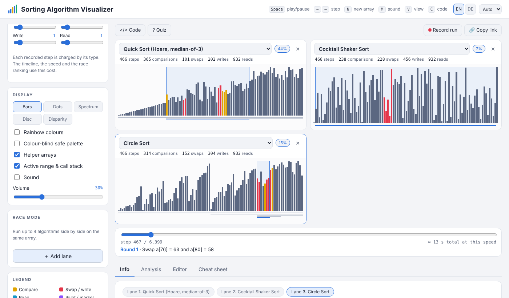

# Sorting Algorithm Visualizer

*[English](README.md) · Deutsch*

Eine interaktive Web-App ohne Abhängigkeiten, die **42 Sortieralgorithmen** animiert, von Bubble
Sort über pdqsort und Timsort bis Spaghetti Sort. Man kann sie gegeneinander antreten lassen, ihr
Wachstum messen oder eigene schreiben.

**[▶ Live-Demo](https://postleitzahl1234.github.io/sorting-visualizer/)**

## Funktionen

- **42 Algorithmen** in 8 Familien (Austausch, Auswahl, Einfügen, Merge, Quicksort, Verteilung,
  Sortiernetzwerke, Spaß-Algorithmen)
- **Rennmodus:** bis zu 4 Algorithmen auf demselben Array, gewertet nach einem einstellbaren
  **Kostenmodell**
- **11 Eingabemuster** (fast sortiert, Orgelpfeife, wenige Werte, Stabilitätstest,
  McIlroy-„Killer“ …) oder ein selbst gezeichnetes Array
- **Live-Statistik:** Schritte, Vergleiche, Tausche, Schreib- und Lesezugriffe, Hilfsarrays,
  Aufrufstapel
- **5 Ansichten**, Ton, farbenblind-sichere Palette
- **Schrittweise Wiedergabe** mit Zeitleiste und Erklärung jedes Schritts
- **Analyse:** Log-Log-Wachstumsdiagramm
- **Editor:** eigenen Algorithmus schreiben. Er läuft in einem Web Worker mit Zeitlimit.
- Pseudocode, Quiz, Spickzettel, Infoseite je Algorithmus
- **Aufnahme** als WebM-Video, **Link kopieren** zum Teilen
- Oberfläche auf Deutsch/Englisch, helles/dunkles Design, Tastenkürzel

## Starten

Kein Build nötig: `index.html` im Browser öffnen oder die Live-Demo nutzen.

## Lizenz & Entstehung

MIT-Lizenz, siehe [LICENSE](LICENSE).

Entwickelt mit KI-Unterstützung (Claude); Konzept, Auswahl der Funktionen, Tests und Gestaltung
stammen von mir.
