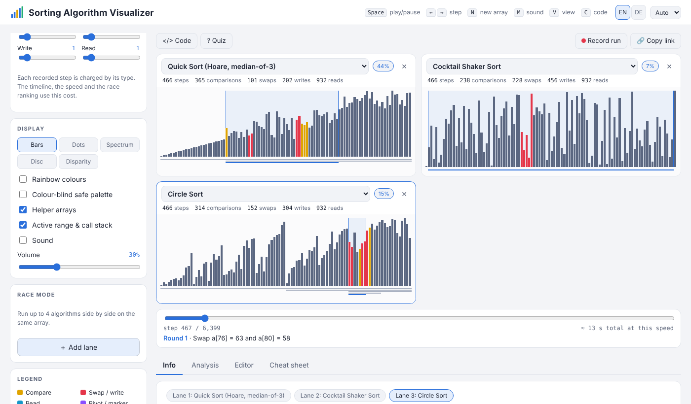

# Sorting Algorithm Visualizer

*English · [Deutsch](README.de.md)*

An interactive, dependency-free web app that animates **42 sorting algorithms**, from Bubble Sort
to pdqsort, Timsort and Spaghetti Sort. You can race them side by side, measure how they scale, or
write your own.

**[▶ Live demo](https://postleitzahl1234.github.io/sorting-visualizer/)**



## Features

- **42 algorithms** in 8 families: exchange, selection, insertion, merge, quicksort, distribution,
  sorting networks, and joke sorts (Bogo, Sleep, Spaghetti).
- **Race mode:** up to 4 algorithms on the same array, ranked by a configurable **cost model**
  (for example "writes ×10" for flash memory).
- **11 input patterns**, including nearly sorted, organ pipe, few unique values, a stability test
  and a McIlroy quicksort "killer". You can also draw your own array.
- **Live statistics:** steps, comparisons, swaps, writes and reads, plus helper arrays and the
  call stack.
- **5 views** (bars, dots, spectrum, disc, disparity), sound, rainbow and colour-blind palettes.
- **Step-by-step playback** with a timeline and an explanation of every step.
- **Analysis tab:** log-log growth chart of operation counts against array size.
- **Editor:** write your own algorithm against a small tracker API. It runs in a Web Worker with a
  time limit, so an endless loop can't freeze the page.
- **Learning extras:** pseudo-code panel, quiz, cheat sheet, and an info page per algorithm.
- **Record run** to a WebM video, and **copy link** to share the exact setup.
- English / German UI, light / dark theme, keyboard shortcuts.

## Run it

No build and no dependencies. Open `index.html` in a browser, or use the live demo.

| Key | Action |
|-----|--------|
| `Space` | play / pause |
| `←` `→` | step |
| `N` | new array |
| `M` | sound on/off |
| `V` | switch view |
| `C` | code panel |

## Structure

```
index.html
css/style.css
js/algorithms.js   all 42 algorithms, instrumented to record every operation
js/render.js       canvas renderer for the five views
js/app.js          UI, playback, race mode
js/analysis.js     growth chart
js/editor.js       custom-algorithm editor (Web Worker sandbox)
js/recorder.js     background recording of traces
js/export.js       WebM export
js/quiz.js, js/algo-info*.js, js/i18n.js   learning content, EN/DE texts
```

## License & credits

MIT, see [LICENSE](LICENSE).

Built with AI assistance (Claude). The concept, feature choices, testing and design direction are
mine.
